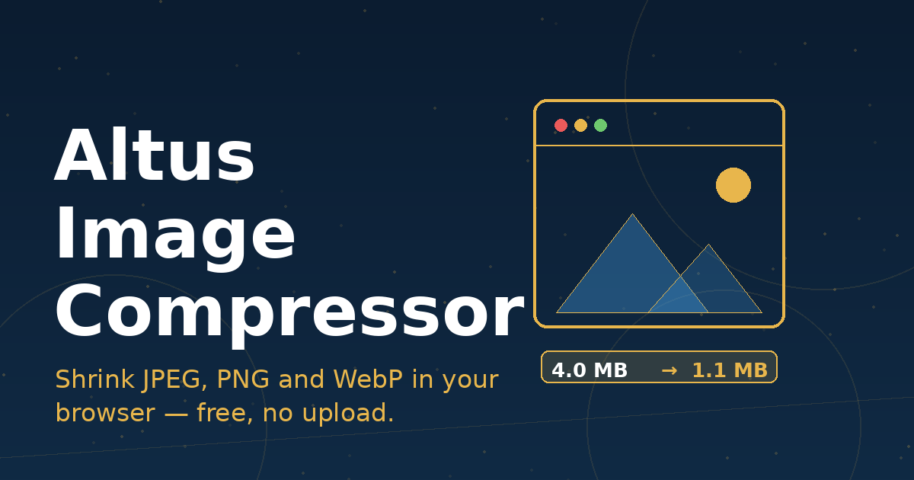

# Altus Image Compressor — Free WordPress Plugin

**A free image compressor for WordPress: shrink JPEG, PNG and WebP images right in your browser — quality slider, one-click resize, honest before/after savings and instant download — with no account and no upload.**

> **⬇️ Download now:** get the latest release zip from the [**Releases page**](../../releases) → WordPress → Plugins → Add New → Upload Plugin → Install Now → Activate → add the shortcode `[altus_image_compressor]` to any page.

**Keywords people search for:** image compressor, compress images for website, free image compressor, shrink images online, compress jpeg, compress png, convert to webp, reduce image size, image optimizer wordpress plugin, compress images for website uk, resize images for web.

## What it does

Most small-business websites are not slow because of anything complicated. They are slow because of images: a 4 MB photo straight off a phone sitting on a homepage, a PNG screenshot where a JPEG would do, five "quick uploads" that were never touched. Every one of them has to download before your visitor sees the page properly — and on mobile data, that wait costs you customers.

Altus Image Compressor fixes that in about thirty seconds. A visitor drops in a JPEG, PNG or WebP image (up to 25 MB) and gets a file summary — name, size, dimensions and a preview — then picks an output format, drags a quality slider, resizes in one click, and downloads the smaller file. The whole thing runs in the visitor's own browser using the native Canvas API. Nothing is uploaded to any server, nothing is stored, nothing is seen by anyone.

## Who it is for

- **Small-business owners** whose website feels slow and who suspect their images are the cause — they can shrink the heavy ones themselves in seconds, without hiring anyone or installing software.
- **Bloggers and content creators** who upload photos straight from a phone and want them web-ready before they hit the page.
- **Freelancers, web designers and agencies** who need a quick, honest compression step for client images — with real savings numbers they can show the client.
- **Anyone who has ever been told "your images are too big"** and wants a tool that tells them the truth about what changed, instead of a vanity number.

## The problem it solves

Compressing an image is simple in theory and fiddly in practice. You need three levers — quality, resize and format — and most free tools give you one of them, hide the result behind an email form, or upload your image to their server first. Worse, many of them never tell you whether the "compressed" file actually got smaller.

This plugin gives you all three levers, shows you the truth about the result, and never uploads anything. The before/after numbers are right there on the page: original size, compressed size, exact percentage saved, and a plain-English verdict. If the result somehow grew — it happens with already-optimised images — the tool says so and suggests what to try instead.

## Features — and why each one matters

### Three levers, not one

- **Quality slider, 10–100%** (hidden for PNG, where quality doesn't apply). Why it matters: around 80% quality looks identical to the original on a screen but is dramatically smaller. You drag one slider; the tool does the rest.
- **Resize presets in one click: 640, 1024, 1600 or 2560 pixels** — labelled with their real jobs (thumbnails, blog images, hero banners, large screens). Why it matters: a phone photo is often 4000 pixels wide while your site shows it at 800–1600. Shrinking the dimensions is frequently the single biggest saving you can make.
- **Format choice: same as original, JPEG, WebP or PNG** — with plain-English advice for each. Why it matters: JPEG is smallest for photos, PNG is lossless (so it stays bigger — fine for logos), and WebP is the modern sweet spot: sharp and tiny. The tool tells you honestly which choice saves what, including the traps.

### Honest results, not vanity numbers

- **Original size vs compressed size, exact percentage saved, and a plain-English verdict** ("Great saving." and friends). Why it matters: you can see with your own eyes — and numbers — whether the compression was worth it.
- **Side-by-side before/after previews with dimensions shown.** Why it matters: numbers alone don't prove quality. The previews let your eyes confirm what the numbers claim before you download.
- **An honest warning if the output grew.** Why it matters: with already-optimised images the "compressed" file can come out bigger. The tool tells you and suggests converting to WebP or lowering the quality, instead of letting you download a bigger file by mistake.

### The traps, caught before you download

- **PNG-to-JPEG transparency warning.** Why it matters: JPEG cannot keep transparency — see-through areas of a PNG become white. The tool warns you before you download, not after you've uploaded the result to your site.
- **PNG output advice.** Why it matters: PNG is lossless, so PNG output barely shrinks at all. The tool says so plainly, so you don't waste a click wondering why nothing changed.
- **File validation with plain-English errors.** Why it matters: wrong file type, empty file, or a file over 25 MB gets a clear message instead of a silent failure.

### Private by design

- **100% client-side: native Canvas API, no CDNs, no uploads, no third-party libraries.** Why it matters: your images never leave your device. There is no server to leak them, no queue to wait in, and no account to create. The only thing that ever leaves the browser is the finished file — downloaded by you, to your own device.
- **No email gate in this version.** Why it matters: the result is a download button, not a form. You get your file immediately, with no name and email address required.

### A download that files itself

- **Download button with a smart filename** built from the original name plus the new format. Why it matters: `test-photo-compressed.jpg` is a file you can find again; `download (3).jpg` is not.

## How it works

1. Add the shortcode `[altus_image_compressor]` to a page.
2. A visitor drags in an image (JPEG, PNG or WebP, up to 25 MB) — or clicks to choose one. The file summary appears instantly: name, size, dimensions and a preview.
3. They pick an output format (the tool gives honest advice, like warning that PNG output barely shrinks), drag the quality slider (80% is the sweet spot for most photos), and pick a resize preset — or keep the original size.
4. They click **Compress image** and get the results grid: original size, compressed size, percentage saved, a verdict, and side-by-side previews — plus an honest warning if the result grew, or a transparency warning for PNG-to-JPEG.
5. They click **Download compressed image** and get the smaller file, with a smart filename. Done.

Everything happens in the browser. No account, no email address, no data sent anywhere.

## Installation (2 minutes, from the release zip)

1. Download the latest `altus-image-compressor-v1.0.0.zip` from the [**Releases page**](../../releases).
2. In WordPress, go to **Plugins → Add New → Upload Plugin**, choose the zip, click **Install Now**, then **Activate**.
3. Create or edit a page and add the shortcode: `[altus_image_compressor]`
4. Publish the page. Done — visitors can compress images from it.

## Frequently asked questions

**Is the Image Compressor really free?**
Yes. Every compression, every format and every download is free, with no account needed.

**Will compressing hurt my image quality?**
Barely, if you do it right. Around 80% quality looks identical to the original on screens while being dramatically smaller — the tool defaults there. Drop lower and you'll start to see softness; the before/after preview lets you check with your own eyes before downloading.

**Which formats can I compress?**
JPEG, PNG and WebP — the three formats websites actually use. Other image types (like GIF or BMP) aren't supported; convert them to one of the three first.

**Is there a size limit?**
You can compress images up to 25 MB — comfortably more than any sensible web image. If your file is bigger than that, resize it once in any photo app first, then bring it here.

**Are my images uploaded to your servers?**
No. The compression runs entirely inside your browser on your own device. We never see, store or process your images. In this open-source version there is no email option at all — the compressed file is downloaded straight from the page.

**What size should my website images be?**
Match the size they'll actually display at. Blog images: 1024 px wide is plenty. Hero banners: 1600 px. Thumbnails: 640 px. Anything bigger is just weight your visitors download for nothing. The tool's resize presets are labelled with exactly these uses.

**What happens if the compressed file is bigger than the original?**
It happens with images that are already well optimised. The tool warns you honestly and suggests converting to WebP or lowering the quality instead of letting you download a bigger file by mistake.

**Should I keep my original?**
Yes — always. Compress copies for the web, never the only original. If you compress the original itself, the lost quality is gone forever.

## Honest limits

- **Compression quality depends on the source.** A photo that is already heavily compressed won't shrink much further — the tool tells you honestly when that happens.
- **PNG output barely shrinks.** PNG is lossless, so converting to PNG (or keeping PNG) keeps the file big. For photographs, JPEG or WebP will always win — the tool says so on the page.
- **JPEG cannot keep transparency.** See-through areas of a PNG become white in JPEG output. The tool warns you, but it can't invent transparency in a format that doesn't support it.
- **25 MB input cap, JPEG/PNG/WebP only.** Very large files and other formats (GIF, BMP, TIFF, AVIF) are rejected with a plain-English message.
- **Quality is a judgement call.** The tool defaults to 80% because it looks identical on screens for most photos, but a detailed hero image may deserve 85–90%. Check the preview — your eyes are the final judge.
- **Modern browsers only.** Compression uses the Canvas API in the browser; very old browsers may not support it.

## Changelog

### 1.0.0

First public release (stripped open-source version). Drag-and-drop compression for JPEG, PNG and WebP (up to 25 MB) with quality slider 10–100%, resize presets (640/1024/1600/2560 px), format choice with honest advice, before/after savings and verdict, side-by-side previews, transparency warning for PNG-to-JPEG, and smart-filename download. Email delivery, lead storage and email sending removed — the full result is downloaded from the page instead. The compression logic passed a 51-test Node harness in the original build (file validation including type/size/empty caps, dimension-scaling math, savings %, format advice strings, transparency warnings, quality clamping, verdict labels).

## What data does this tool handle?

This GitHub version contains NO lead capture, NO email sending, and NO data storage — results are shown on screen only. The version hosted on altuswebsolutions.com may offer email delivery; this open-source version does not. The visitor's image never leaves their browser: there is no server endpoint in this version, no database table is created, no file is written on the server, and nothing is transmitted to any external service. Images are compressed in the browser and downloaded directly to the visitor's device.

## Disclaimer

This software is provided free of charge, "as is", WITHOUT warranty of any kind, express or implied, including but not limited to the warranties of merchantability and fitness for a particular purpose. The authors are NOT liable for any loss, damage or cost arising from the use of this software, including but not limited to loss of image quality, lost files, or time spent installing it. Always keep your original full-size images as backups and back up your WordPress site before installing any plugin, and test new plugins on a staging site where possible. Compress copies for the web — never the only original.

## Licence

GPLv2 or later. See [LICENSE](LICENSE).
